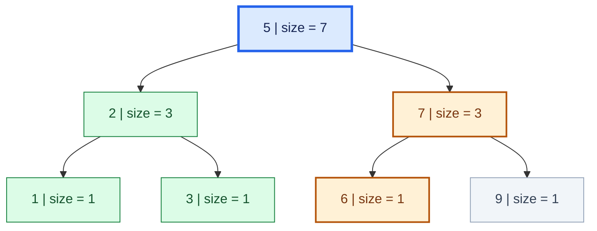
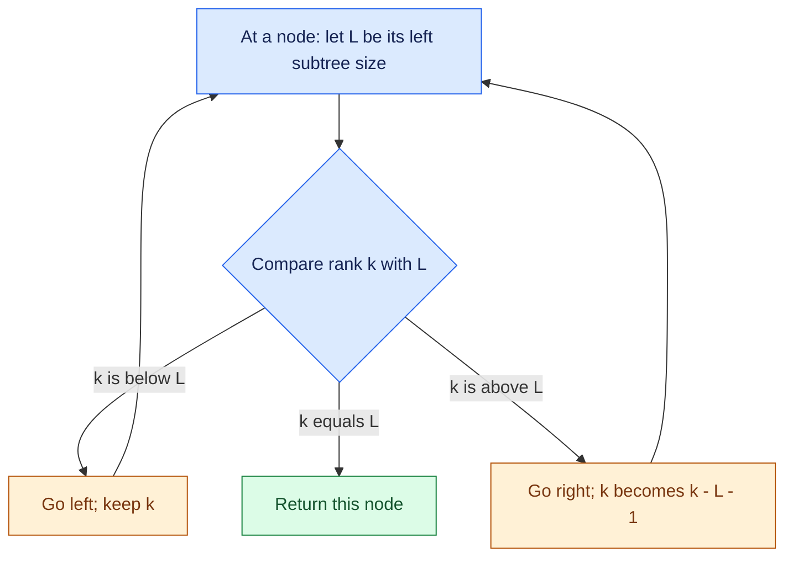
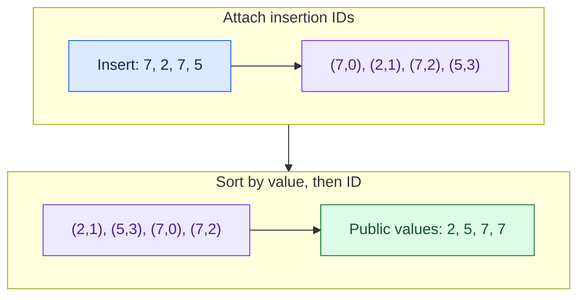

# The Missing Index in C++ Sets

## Building an ordered set you can read, query, and actually enjoy using

You are keeping a collection of numbers. New values arrive, old values leave, and the collection needs to stay sorted. Then someone asks a slightly different question:

**“What is the third-smallest value right now?”**

A vector answers that question easily—until an insertion forces its elements to move. A set handles insertions and erasures—until you try to count how far an iterator is from the beginning.

This is the gap an **order-statistics tree** fills. It keeps values ordered and remembers enough about its own shape to answer questions about positions without walking through all the preceding values.

In this guide, we will follow the counting idea through a small tree, handle repeated values properly, and finish with two reusable C++ containers: `ordered_set` and `ordered_multiset`.

**Repository: publication URL pending.**

## Start with the interface

An ordered set is still a set. A unique set keeps one equivalent key; a multiset keeps repeated occurrences. The extra feature is access by **sorted rank**.

<!-- example: QuickStart -->
```cpp
ordered_set<int> s = {7, 2, 7, 5};
ordered_multiset<int> ms = {7, 2, 7, 5};

cout << s.size() << '\n';                           // 3
cout << ms.size() << '\n';                          // 4
cout << s[0] << '\n';                               // 2
cout << ms[2] << '\n';                              // 7
cout << ms.order_of_key(7) << '\n';                 // 2
cout << ms.order_of_key_upper(7) << '\n';           // 4
cout << ms.count(7) << '\n';                        // 2
cout << ms.count_range(5, 7) << '\n';               // 3

ms.erase_one(7);
cout << ms.count(7) << '\n';                        // 1

ms.erase(7);
cout << ms.contains(7) << '\n';                     // 0

for (int value : ms) {
    cout << value << ' ';
}
cout << '\n';                                       // 2 5
```

The sorted multiset begins as `{2, 5, 7, 7}`. Its ranks are `0, 1, 2, 3`. The last two values are equal, but they occupy two separate positions.

`s[0]` means the first value in the current sorted order. It does not mean “the first value I inserted.” As the collection changes, ranks can change too.

The bracket syntax is convenient, but the work behind it is logarithmic: `O(log(n + 1))`, where `n` is the number of stored occurrences. A new pair of brackets does not persuade a tree to become a vector. :)

## The useful detail hidden inside the tree

In a binary search tree, each node stores one key. Its children lead to keys ordered before and after it. Keeping such a tree balanced prevents a long chain from forming after unlucky insertions.

Now add a single count to every node: **the number of nodes in its subtree, including itself**.

<!-- diagram: subtree-sizes -->


*Figure 1. A schematic tree for `1, 2, 3, 5, 6, 7, 9`. The root stores size seven; its left subtree contains three values. Green marks the group a query can skip, blue marks the starting node, and amber marks the route toward six. These colors explain the query; they are not red-black balancing colors.*

The rule for the count is small:

```text
subtree size = left subtree size + 1 + right subtree size
```

For a missing child, its size is zero. For a leaf, both children are missing, so its size is one.

The exact drawing is illustrative. Our C++ implementation delegates balancing to GNU PBDS’s red-black tree; that library may choose a different valid shape. Rank and selection use the same subtree-size principle in any valid balanced shape.

## Finding a value by its position

Suppose we want rank four in the picture. The sorted values are `1, 2, 3, 5, 6, 7, 9`, so the answer should be six.

At the root, the left subtree contains three elements. That puts the root itself at rank three. Our target is later, so the entire left subtree **and the root** can be skipped: four elements in one decision.

We move right and subtract four from the requested rank. We now want rank zero within that right subtree.

At node seven, the left subtree contains one element. Rank zero is before the current node, so we move left. Node six has no left child; its local rank is zero. We found the answer.

<!-- diagram: select-walk -->


*Figure 2. Selection compares the target rank with the left subtree’s size. Moving right adjusts the rank; moving left keeps it unchanged. This flow assumes a valid initial rank.*

This is what `find_by_order(i)` does conceptually. The wrapper’s `s[i]` checks the rank and returns the selected value as a const reference.

Only one path is visited. Because the underlying tree stays balanced, that path has logarithmic length.

## Turning the question around: how many values come before x?

Now ask how many values are smaller than six in the same tree.

At node five, every value in its left subtree is smaller than six. The node itself is smaller too, so add `3 + 1 = 4` and move right.

At node seven, the current value is too large. Do not add it or its right subtree; move left.

At node six, equality does not count for a strict “smaller than” query. Move left again, reaching a missing child. The answer is four.

This is the idea behind `order_of_key(x)`. With the default ascending comparator, it counts values `< x`. A second operation, `order_of_key_upper(x)`, includes equivalent values and therefore counts `<= x`.

For `{2, 5, 7, 7}`, the lower rank of seven is two and the upper rank is four. Their difference gives the number of sevens: two. Counting duplicates does not require walking over them.

The interactive version accompanying this article lets you change the values, choose a rank or threshold, and step through the decisions. Every step shows what was counted or skipped.

**Interactive walkthrough: publication URL pending.**

<!-- INTERACTIVE LAB -->

## The library already knows how to balance the tree

GNU C++ provides a policy-based data structures extension, usually called **PBDS**. Its order-statistics policy maintains the subtree metadata we have been discussing.

The underlying unique-key declaration looks like this:

<!-- example: RawPBDS -->
```cpp
using RawOrderedSet = __gnu_pbds::tree<int, __gnu_pbds::null_type,
                                     less<int>, __gnu_pbds::rb_tree_tag,
                                     __gnu_pbds::tree_order_statistics_node_update>;

RawOrderedSet s;
s.insert(2);
s.insert(5);
s.insert(7);

cout << s.order_of_key(6) << '\n';                  // 2
cout << *s.find_by_order(1) << '\n';                // 5
```

The long declaration specifies the key type, no mapped value, the comparator, a red-black tree backend, and the policy that maintains subtree sizes. [GCC’s API documentation](https://gcc.gnu.org/onlinedocs/gcc-10.4.0/libstdc++/api/a10587.html) describes the rank and selection operations.

Our wrapper gives those capabilities a smaller everyday interface. It does not keep a second sorted vector or a separate frequency map. The tree does the ordering and counting; the class handles the public contract.

Use GCC with GNU libstdc++ or Clang with that library, in C++17 mode or newer. PBDS is a GNU extension and is not supplied by plain MSVC’s standard library. The C++ container itself has no JavaScript or diagramming dependency.

## Repeated values need identity, not a relaxed comparison

There is a tempting shortcut: change the comparator from `less` to `less_equal`, so two equal values appear to be allowed.

That breaks a tree’s ordering contract. An ordered search tree needs a **strict weak ordering**, including the rule that a key does not compare before itself. `less_equal(7, 7)` is true. The resulting search and bound behavior should not be treated as a multiset implementation. [The C++ associative-container requirements explain the ordering rule](https://eel.is/c++draft/associative.reqmts).

Instead, give each inserted occurrence an internal ID:

<!-- diagram: duplicate-ids -->


*Figure 3. IDs distinguish equal occurrences. Ordering uses the value first and the ID only for equivalent values. The public interface returns the value alone.*

Insertions of `7, 2, 7, 5` receive IDs `0, 1, 2, 3`. After sorting, `(7, 0)` comes before `(7, 2)`. The two sevens stay distinct without breaking strict ordering.

An ID is a counter here. It is not a random priority or a hash, so this technique introduces no collision probability. Equivalent occurrences retain their insertion order.

The public iterator hides the second field. You write `*it`, `it->member`, or `ms[i]` and receive the original value. Internally, the ID also lets `index_of(it)` find the rank of the exact occurrence rather than merely the first equivalent value.

Value lookups compare the searched value directly while walking the tree. They do not construct temporary pair keys or invent artificial minimum/maximum values. That matters for strings, custom objects, and integers at their limits.

## A few declarations you can keep in a template

<!-- example: Construction -->
```cpp
ordered_set<int> a;
ordered_set<long long> b = {9, 2, 9};
ordered_multiset<string> names = {"Ali", "Tareq", "Ali"};
ordered_set<pair<int, int>> pairs = {{2, 3}, {1, 4}};

vector<int> v = {8, 3, 8, 1};
ordered_multiset<int> fromVector(v.begin(), v.end());
ordered_set<int> uniqueValues(v.begin(), v.end());

cout << b.size() << '\n';                           // 2
cout << names.count("Ali") << '\n';                 // 2
cout << pairs[0].second << '\n';                    // 4
cout << fromVector[2] << '\n';                      // 8
cout << uniqueValues.size() << '\n';                // 3
cout << a.empty() << '\n';                          // 1
```

`T` is the stored type. The optional second template parameter controls the ordering. The multiset’s optional third parameter controls the unsigned insertion-ID type.

For descending order:

<!-- example: Descending -->
```cpp
ordered_multiset<int, greater<int>> s = {2, 9, 4, 9};

cout << s[0] << '\n';                               // 9
cout << s.order_of_key(4) << '\n';                  // 2: values before 4 are 9, 9
cout << *s.lower_bound(5) << '\n';                  // 4
cout << s.count_range(9, 3) << '\n';                // 3: 9, 9, 4
cout << s.count_range(3, 9) << '\n';                // 0: reversed in this ordering
```

The word to remember is **before**. With `greater<int>`, nine comes before four. Rank zero is the largest value, and a range from nine through three is written `count_range(9, 3)`.

For custom objects, equivalence also follows the comparator:

<!-- example: CustomKeys -->
```cpp
struct Player {

    string name;
    int score;

};

struct ComparePlayer {

    bool operator()(const Player& a, const Player& b) const {

        return a.score > b.score;

    }

};

ordered_multiset<Player, ComparePlayer> players;
players.insert({"Ali", 100});
players.insert({"Tareq", 100});
players.insert({"Omar", 80});

cout << players[0].name << '\n';                    // Ali
cout << players[1].name << '\n';                    // Tareq
cout << players.count({"Anyone", 100}) << '\n';     // 2
cout << players.begin()->score << '\n';             // 100
```

Here the comparator considers only the score. Two players with the same score are equivalent keys, even when their names differ. The multiset retains both. A unique set using the same comparator would retain only the first one.

Keys must be copyable for the PBDS backend. A supplied custom comparator can avoid any need for `operator<`, arithmetic, or `operator==`. Stateful comparators are supported too, provided their ordering remains consistent while the container holds keys.

## Two places where the interface earns its keep

### Counting inversions

An inversion is a pair of positions `i < j` whose values satisfy `v[i] > v[j]`. Read values from left to right. When a new value arrives, ask how many earlier values are strictly greater.

<!-- example: Inversions -->
```cpp
long long CountInversions(const vector<int>& v) {

    ordered_multiset<int> s;
    long long ans = 0;
    for (int value : v) {
        ans += s.size() - s.order_of_key_upper(value);
        s.insert(value);
    }
    return ans;

}
```

We subtract the **upper** rank so equal values do not count as inversions. For `{3, 1, 2, 2}`, the result is three. The algorithm takes `O(n log(n + 1))` time and `O(n)` extra space. The answer must fit in `long long` for this function.

### Sliding lower medians

A moving window repeatedly inserts one value, removes one value, and asks for its median. That is almost a sentence made out of this container’s operations.

<!-- example: SlidingMedian -->
```cpp
vector<int> SlidingMedian(const vector<int>& v, int k) {

    if (k < 1 || (size_t)k > v.size()) {
        throw invalid_argument("Invalid window size");
    }

    ordered_multiset<int> s;
    vector<int> ans;
    for (size_t i = 0; i < v.size(); i++) {
        s.insert(v[i]);
        if (i >= (size_t)k) {
            s.erase_one(v[i - k]);
        }
        if (i + 1 >= (size_t)k) {
            ans.push_back(s[(k - 1) / 2]);
        }
    }
    return ans;

}
```

For `{5, 1, 5, 2, 9, 2}` and a window size of three, the answers are `5, 2, 5, 2`. For an even window size, `(k - 1) / 2` chooses the lower of the two middle values. Runtime is `O(n log(k + 1))`; the tree stores `O(k)` elements, apart from the output vector.

The quiet but important line is `erase_one`. Removing all copies of the outgoing value would silently damage a window containing duplicates.

## The contract behind the convenience

Indexed access returns a read-only reference. Assigning through `s[0]` would let a value change without being placed back in sorted order, so it is intentionally disallowed. To change a key, erase it and insert the replacement.

Invalid `s[i]` and `at(i)` calls throw `out_of_range`. Invalid `find_by_order(i)` calls return `end()`. Empty `front()` and `back()` calls also throw. Ordinary iterator operations still require a valid iterator; do not dereference `end()`.

`erase(x)` removes every equivalent occurrence and returns the count. `erase_one(x)` removes at most one and returns a bool. Erasing by iterator identifies one exact occurrence. Iterator-range erasure uses a half-open range; `count_range(a, b)` uses an inclusive **value** range.

Existing element iterators survive insertions and unrelated erasures. Erasing an element invalidates its iterator; clearing invalidates all element iterators. After moving or swapping, iterators follow their elements to the receiving container, but end iterators should be reacquired.

The default 64-bit ID counter allows `2^64 - 1` successful insertions between clears, counting entries later erased. It throws before wraparound. Ordinary erasures do not reset IDs; `clear()` does. A narrower unsigned ID type can be chosen explicitly, but padding may absorb any storage saving.

<!-- example: NarrowId -->
```cpp
ordered_multiset<int, less<int>, uint32_t> s;
s.insert(5);
cout << s[0] << '\n';                               // 5
```

Most individual search, rank, selection, insertion, and single-erasure operations cost `O(log(n + 1))`. Full traversal costs `O(n)`. Size and cached endpoints are constant-time. Bulk erasure performs individual tree erasures, so removing `q` equivalent occurrences costs `O((q + 1) log(n + 1))` in the multiset.

The wrapper supports copying, moving, swapping, range construction, and initializer lists. Moving creates an empty PBDS sentinel and can allocate, so move operations are not `noexcept`. `emplace` constructs a value before inserting it; it does not promise zero-copy in-place node construction.

The full API reference documents every overload, return type, complexity, and iterator precondition. The repository also includes a standalone `.cpp` file for judges where you paste one whole source file instead of uploading a local header.

## What is worth measuring?

Templates do not require a runtime type switch here. The unique wrapper stores one PBDS tree. The multiset adds one counter per container and an ID inside each stored key. Both use `O(n)` node storage.

Actual node bytes depend on types, alignment, the allocator, and the library. `sizeof(container)` excludes its dynamically allocated nodes, and a narrower ID does not guarantee a smaller allocation.

The useful improvements are easy to explain: subtree counts avoid scanning, upper ranks avoid `x + 1` tricks, direct multiset searches avoid copying lookup keys, and IDs preserve a valid ordering for duplicates. Benchmark results belong next to the workload and toolchain that produced them, rather than beside a claim that one container always wins.

If you never need ranks, a normal set may be enough. If all coordinates are known, a compressed Fenwick tree can be a compact alternative for frequencies. If you need split/merge operations or custom augmentation, a treap may be a better fit. Choose the structure for the operations your problem actually needs.

## Copy it, test it, and keep the small details visible

The supplied suite compares these containers with standard sets and multisets, tests both ordering directions, and checks custom types, numeric limits, iterators, copy/move/swap, and ID exhaustion. Each successful full suite run includes 27,073,587 checks, with randomized operations and bounded exhaustive traces. The examples above are extracted and compiled, and the recipe functions are compared with simple reference solutions.

The exact compiler results and any execution restrictions are recorded with the project. Tests give us evidence and useful regression cases; the ordering invariant explains why the method works.

The central idea is small enough to keep in mind: **store the size of each subtree, then count whole groups instead of individual elements**. The reusable class is there so that idea is convenient to use on the next problem.

**Repository: publication URL pending.**

*By Tareq Ali. This article was organized with AI assistance.*
