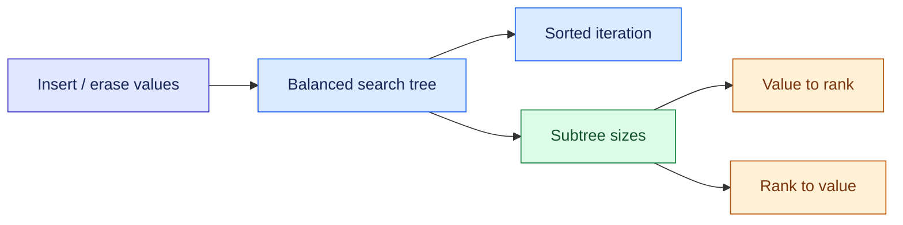

# Organized C++ Ordered Set

Generic, set-like C++ containers with sorted-rank access, correct duplicate handling, and a documented interface.

[GitHub repository](https://github.com/Tareq-Ali-1998/Organized-CPP-Ordered-Set) · [GitLab mirror](https://gitlab.com/tareqali591998/organized-cpp-ordered-set)

```cpp
ordered_set<int> s = {7, 2, 7, 5};
ordered_multiset<int> ms = {7, 2, 7, 5};

cout << s[0] << '\n';                               // 2
cout << ms.count(7) << '\n';                        // 2
cout << ms.order_of_key(7) << '\n';                 // 2
cout << ms.count_range(5, 7) << '\n';               // 3

ms.erase_one(7);                                    // remove one occurrence
ms.erase(7);                                        // remove all remaining occurrences
```

Requires **C++17 or newer, GNU libstdc++, and PBDS**. GCC works; Clang works with that library. Plain MSVC does not supply PBDS. All ranks are zero-based. `s[i]` is checked, read-only access in `O(log(n + 1))` time.

<!-- BEGIN DIAGRAM overview -->

<!-- END DIAGRAM overview -->

The tree maintains subtree sizes to answer ranks without scanning earlier elements. The multiset uses strict `(value, insertion ID)` ordering; it does not use `less_equal`, hashing, or random priorities.

## Use the code

Include [OrderedSet.hpp](OrderedSet.hpp) with your other includes, before defining macros. Then declare `ordered_set<T>`, `ordered_multiset<T>`, or an ordering such as `ordered_set<int, greater<int>>`.

For a judge that accepts one source file, [OrderedSet.cpp](OrderedSet.cpp) contains the same implementation plus an example driver. Replace its `SolveTestCase` and `main` with your solution. There are no custom includes to upload.

```bash
g++ -std=c++17 -O2 -Wall -Wextra -pedantic Example.cpp -o Example
./Example
```

Windows users can also open [OrganizedOrderedSet.cbp](OrganizedOrderedSet.cbp) in Code::Blocks with a GCC toolchain. A [CMake project](CMakeLists.txt) is included for other local workflows.

## Choose where to start

**No build is needed to use the header or read the tutorial.** Download the project and open `index.html` in a browser, keeping `assets/` beside it. The generated pages and diagrams are already included. Python, Node.js, and CMake are maintenance tools, not C++ library dependencies.

On GitHub or GitLab, an HTML file link normally opens the repository's source viewer. Download the folder for local interaction, or use the hosted Pages URL once configured.

| File | What it contains |
|---|---|
| [API reference](docs/API.md) | Every public function, overload, return value, complexity, and iterator rule |
| [Examples](docs/Examples.md) | Strings, pairs, custom comparators, inversion counting, and sliding medians |
| [Medium.md](Medium.md) | The detailed visual article, with Mermaid sources |
| [Interactive visual guide](index.html) | Colored article with rendered diagrams and an interactive rank/select walkthrough; opens locally |
| [Medium.publish.md](Medium.publish.md) | Medium publishing copy using PNG diagrams instead of Mermaid fences |
| [Codeforces.md](Codeforces.md) | A separate contest-focused article with LaTeX math and collapsible full code |
| [Codeforces.html](Codeforces.html) | Local reading preview of the Codeforces draft |
| [Publishing guide](docs/Publishing.md) | Platform-specific steps, image captions, public URLs, and export instructions |
| [Project guide](docs/ProjectGuide.md) | What each helper does, which files to edit, and how to fix stale-file messages |
| [Validation](docs/Validation.md) | Actual test results and their limits |

GitHub and GitLab render fenced Mermaid diagrams in Markdown. The HTML copies use diagrams rendered from those Mermaid sources, with a pinned local renderer for interactive updates. Medium stories use PNG images and a link to the interactive version; they do not execute this project's JavaScript.

`Medium.html` and `index.html` are identical interactive guides; `index.html` is the website entry point. `Medium.publish.html` is a static preparation copy with PNG diagrams, which makes copying prose and preparing Medium uploads easier. Publish `Codeforces.md` through the Codeforces editor and prepare the Medium story from `Medium.publish.md`; neither platform is a destination for pasting the complete HTML application.

## Bounds that matter

Insertion, lookup, rank, selection, and single-occurrence erasure take `O(log(n + 1))`. Size and cached endpoints take `O(1)`; a full traversal takes `O(n)`. The multiset stores one tree node per occurrence, including duplicates, and uses `O(n)` space.

`erase(x)` removes all equivalent occurrences and can take `O((q + 1) log(n + 1))` for `q` removals. `erase_one(x)` removes at most one. `emplace` is a construction convenience; PBDS still copies the key into a node. Moves can allocate a sentinel and are not `noexcept`. See the API reference for the full contract.

## Build the documentation and run checks

Python 3.10+ and a GNU-compatible C++ compiler are sufficient for the container tests. The document builder also uses the pinned Python dependency below. Node.js 20+ runs the independent walkthrough-model checks.

```bash
python -m pip install -r requirements-dev.txt
python build.py
python verify.py
```

`python verify.py --full` adds Clang C++17, GCC C++20, and GCC library assertions / UBSan traps. `--documents-only` checks generated content without repeating C++ execution. GitHub Actions and GitLab CI configurations run the full profile and the JavaScript model checks. Reports are written to `validation/Results.json`; executions blocked by local system policy are recorded as blocked, not passed. Use `--report validation/MyRun.json` to keep a separate run.

The scripts resolve paths from their own project folder, so they also work when launched from an editor whose terminal is in a parent directory. A stale-file message means a generated copy differs from its source: rebuild with `python build.py`, then verify again. The builder does not compile C++ or start a server.

`python build.py --check` checks generated files without changing them. The builder never writes outside this project. To publish, first fill the public URLs in [publishing.json](publishing.json), rebuild, and run `python build.py --release-check`. No repository or article URL is invented for an unpublished project.

For Markdown PDF, open [OrganizedOrderedSet.code-workspace](OrganizedOrderedSet.code-workspace). Its local settings send exports to `exports/` and apply the supplied CSS, keeping generated export files separate from the project’s HTML walkthrough. `index.html` is the main interactive entry point.

## Contributing and license

Small reproducing cases and focused improvements are welcome. See [CONTRIBUTING.md](CONTRIBUTING.md). The project is available under the [MIT license](LICENSE); the bundled Mermaid renderer retains its own license in [THIRD_PARTY_NOTICES.md](THIRD_PARTY_NOTICES.md).

By Tareq Ali. The articles and project organization were developed with AI assistance.
